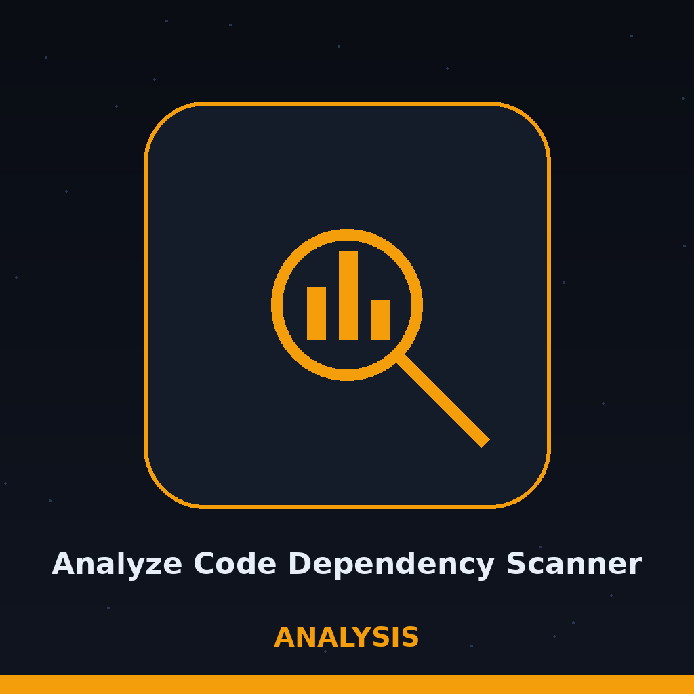

# analyze-code-dependency-scanner

Lists the dependencies a repository declares and checks them against a small built in example table only: requests at 2.28.0 and django at 3.2.0, the two entries in main.py. It does not query public vulnerability databases and does not check whether packages are outdated, so a result with no flags only means no declared package matched those two entries. - Focused on Data analysis and reporting

## Install
`git clone https://github.com/ShadowGuardAI/analyze-code-dependency-scanner`

## Usage
`./analyze-code-dependency-scanner [params]`

## Parameters
- `-h`: Show help message and exit
- `-o`: No description provided
- `-f`: Output format: csv or json. Defaults to csv.
- `-p`: No description provided
- `--ignore-vulnerabilities`: Path to a JSON file containing a list of vulnerabilities to ignore.

## License
Copyright (c) ShadowGuardAI

> Basket note: this scanner does not query public vulnerability databases and does not check whether packages are outdated. No flags means only that no declared package matched requests at 2.28.0 or django at 3.2.0.
> Basket note: the parameters -o and -p arrive with no description provided, and they are printed that way here rather than given a guessed job.
